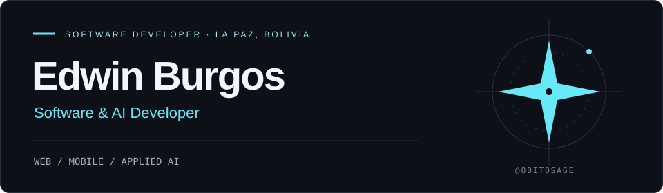
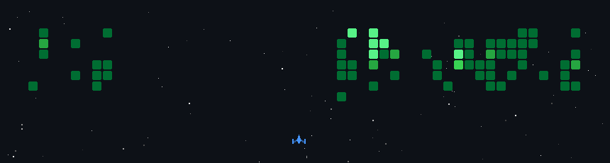

 

  
  
  
  

 

### 👋 About me

I'm a **Computer Systems Engineering student** at Universidad Privada Boliviana (UPB) and a **software developer** who builds web and mobile products end to end — from **React and React Native** interfaces to **NestJS, Express and FastAPI** APIs backed by PostgreSQL, MongoDB and Supabase.

I enjoy bringing **AI into real products**: RAG assistants with vector search, LLM-powered chat and data pipelines. Two-time hackathon winner in 2026, used to working in teams and turning real problems into working software.

 

### 🚀 Projects

  
  
  
  
  
  

 

### 🛠️ Tech stack

  
   <b>Languages</b> · SQL · HTML/CSS  
  
   <b>Frontend · Backend · Mobile</b> · React Native · Expo · Zustand · TanStack Query  
  
   <b>Data &amp; AI</b> · pgvector · RAG · LLMs (Gemini, Llama via NVIDIA NIM, OpenAI) · TensorFlow/Keras  
  
   <b>DevOps &amp; Tools</b> · MinIO/S3 · Render · pytest

<b>Practices:</b> hexagonal architecture · REST APIs · JWT auth · SSE streaming · ACID transactions · RLS

 

### 🏆 Achievements

- 🥇 **1st place · Solutions for My City Hackathon 2026** — Municipal Government of La Paz, with SuperAMI
- 🥇 **1st place · April FinTech Challenge 2026** — Incubatec · Solydes · UPB
- 🎓 **B.S. in Computer Systems Engineering** — Universidad Privada Boliviana (UPB) · 2023–Present
- 🌎 **Languages:** Spanish (native) · English (high-intermediate)

 

<b>🎮 My contributions, as a space shooter</b>

 

 

  Have an idea involving <b>web, mobile or AI</b>? Let's talk. 
  <a href="mailto:burgos3du@gmail.com">Email</a> · <a href="https://www.linkedin.com/in/edwin-josue-burgos-ovale-16204a3b5/">LinkedIn</a>

